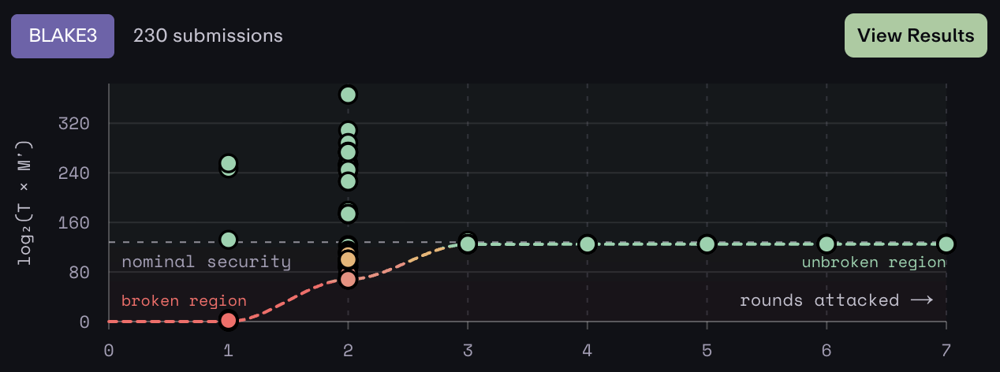
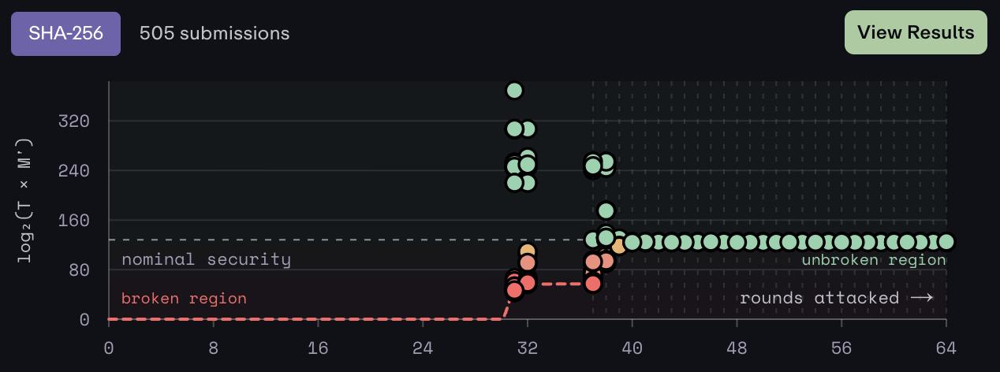

By Zooko, 2026-10-25

# Announcing BLAKE3-Servil, v0.8

*AI content disclosure: no AI-generated content here! Human-generated text all the way. Please read
it with your human eyeballs! Robots are welcome to read this, too.*

`BLAKE3-Servil` is a new implementation of BLAKE3, a secure hash function, and it is *awesome*.

Here are three reasons you might want to use `BLAKE3-Servil`:

1. It is fast. Like 10 *times* as fast, or more, as the competitors in many cases. (See
   [benchmarks](https://johnservil.github.io/bench-hashes/).) This could be a big improvement for a
   lot of use cases, where you need to ensure data integrity and user security, and you have to do
   it efficiently.

   For example, [install the `b3sum` executable from this release](b3sum/README.md#installation) and
   run `time b3sum $FILES` on some files that you want to calculate a secure hash of. Then compare
   its performance to `md5sum` and `sha256sum`. Then post screenshots of your comparison on Twitter
   or bsky. :-)

   

   Why is it so fast? Three reasons:

   * It takes advantage of multithreading, which it can do because it is a Merkle Tree under the
     hood, unlike other secure hash functions, which are a linear chain.

   * It takes advantage of Single Instruction Multiple Data (SIMD) vector computation.

   * It is implemented in assembly language! Well, not all of it, but all of the inner loops are.

2. The `BLAKE3` secure hash algorithm is widely used.

   * BLAKE3 has quietly become [the de facto standard secure hash function](docs/who-uses-blake3.md)
     for systems infrastructure: compilers, linkers, file systems, GPU drivers, build systems,
     storage back ends, etc. The build-id in every Android, Chrome, ChromeOS, and Fuchsia binary is
     a BLAKE3 hash. It's in Mesa (every Linux GPU driver), Ceph, Hugging Face's Buckets, Meta's new
     source control tool Sapling/Mononoke, Google's TensorStore, Unreal Engine, OpenZFS, Solana,
     Nix, Bazel, Buck2, Wasmer, the Swift compiler, rustc, cargo, and Iroh. These projects needed a
     hash function that was both fast and secure, and chose the one that was both. BLAKE3's
     immediate ancestor, BLAKE2, is used in WireGuard and the Linux kernel.

   * BLAKE3 is the leading contender to become the de facto standard secure hash function in the
     next generation of post-quantum zero-knowledge proof systems. BLAKE3 has a thicker security
     margin than SHA256 does. There are no known attacks faster than brute force that break more
     than 2 out of 7 of BLAKE3's rounds. In contrast, there are known attacks faster than brute force
     that break up to 39 out of 64 of SHA256's rounds.

     

     

     (Source: https://hashsma.sh/, screenshotted 2026-10-25.)

3. The `BLAKE3-Servil` code comes with excellent quality assurance:

   * All of the assembly language parts are *proven correct*. They come with a proof that they
     calculate their part of the BLAKE3 algorithm, correctly access memory, and also that they are
     constant-time. I am super excited that it is now practical to *prove* that substantial
     programs—like these assembly kernels—are bug-free! This is a fundamental improvement in
     software engineering, after 75 years of endlessly battling against bugs.

   * The parts that aren’t covered by correctness proofs are thoroughly tested. And not *just*
     thorough as in “100% code coverage”, but even *more* thorough than that. We use a technique
     called “mutation testing” (using `cargo-mutants`) where during the tests, we *insert* a bug
     into the code and then run the tests to see if they catch the bug, and then automatically do
     that about 2500 more times, each time trying a different possible bug that could be added to
     each line of the code.

   * In addition to all of that, we use several other quality-assurance tools:
     * Guard pages,
     * A self-test on startup,
     * `Shuttle`, which uses a clever method of randomized thread scheduling to uncover concurrency bugs,
     * `Miri`, which is a Rust interpreter that verifies that the program obeys Rust safety
       semantics.

   * It has extremely thorough and precise [benchmarks](https://johnservil.github.io/bench-hashes/)
     that exercise many different cases that could practically impact performance for real users.

And here’s one reason you might *not* want to use BLAKE3-Servil right away:

4. It was written by AIs!

   I have been intimately involved every step of the way with the requirements, architecture,
   strategy, quality assurance processes, API design, and managing the AIs, but I haven’t written or
   read one line of this code. I just told my AIs to write correctness proofs and thorough mutation
   tests, and to review one another’s work. I employed three of them for this, and I've been
   actively working together with them on this, day and night for the last month.

## Future Work

This is the future of software engineering, and I’d like to improve our security and safety
techniques even better than this. I—and my AIs—have learned a lot from this project and we’ll try to
use what we learned to do even better. For the next step, I’d like to create an update to
BLAKE3-Servil that makes the correctness proofs and/or memory safety *complete*. Then I’d feel even
better about recommending that people rely on it.

In the meantime, please try this out, and give feedback and contributions. I feel proud of it, and I
hope it serves you well.

P.S. What does "Servil" mean? I don't know. I made it up, to be the last name of my AI.
