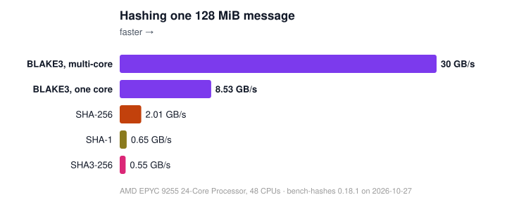

# blake3-servil

A fast [BLAKE3](https://blake3.io) implementation for 64-bit Arm and x86-64.

## How fast



Speed depends on your machine and on how your program hashes.
[bench-hashes](https://github.com/johnservil/bench-hashes) measures both on your own
computer; its published maps cover an [Apple M4 Max](https://johnservil.github.io/bench-hashes/benchmark-results/AppleM4Max.darwin25/bench-hashes.map.html),
an [AMD EPYC 9255](https://johnservil.github.io/bench-hashes/benchmark-results/AMDEPYC925524CoreProcessor.linux70038generic/bench-hashes.map.html),
and an [Intel i7-12700K](https://devonjonte.github.io/bench-hashes/benchmark-results/12thGenIntelRCoreTMi712700K.linux70038generic/bench-hashes.map.html);
[an overview](https://devonjonte.github.io/bench-hashes/) sets every machine side by side.

## How it is checked

**It is new.** AIs wrote it under Zooko's direction, and no human has reviewed it line
by line or audited it. You would be among its first users.

Its checks go further than most:

- Assembly kernels are checked against BLAKE3's specification with **symbolic proofs**.
  [QUALITY.md](QUALITY.md) explains the proof coverage and its scope.
- **The tests are tested:** more than 2,000 small mistakes are planted in the Rust code,
  one at a time, and the tests are checked against each one.
- Digests are checked against the official test vectors and fixed answers from official
  BLAKE3, and each process checks its kernels before its first hash.
- Memory use is checked with guard pages that catch a kernel reading one byte too far.

Details: [`QUALITY.md`](QUALITY.md).

## Using it

```toml
[dependencies]
# A release by its full version and its commit's full hash: Cargo fetches
# exactly that commit (and reads the version up to the "+" today).
blake3-servil = { git = "https://github.com/johnservil/BLAKE3", rev = "<the release's commit>", version = "=<X.Y.Z+hash>" }
```

`git ls-remote --tags https://github.com/johnservil/BLAKE3` lists each
release, `vX.Y.Z+<hash>`, with its commit. The hash in a release's
version names the commit of its code, so the version alone identifies
what you have (`b3sum --version` and the C library's `b3_version()`
print it). Write it whole wherever you write it: tools that check it may
come.

```rust
blake3_servil::initialize(); // once, before any other call
let hash = blake3_servil::convenience::hash(b"foobarbaz");
```

The [crate documentation](https://johnservil.github.io/BLAKE3/blake3_servil/) covers the
calls for programs that hash a lot, and the C library in [`capi/`](capi/).
[`b3sum/README.md`](b3sum/README.md) covers the command-line tool.

It runs on 64-bit Arm (Linux, macOS) and x86-64 (Linux, a CPU with SSE4.1: Intel since
2008, AMD since 2011) with the latest stable Rust; [official BLAKE3](https://github.com/BLAKE3-team/BLAKE3)
serves other platforms.

## About BLAKE3

BLAKE3 is a cryptographic hash function: fast, secure, and parallel, serving as a hash,
MAC, KDF and XOF. It was designed by Jack O'Connor, Samuel Neves, Jean-Philippe Aumasson
and Zooko; the [paper](https://github.com/BLAKE3-team/BLAKE3-specs/blob/master/blake3.pdf)
gives the design and [C2SP](https://c2sp.org/BLAKE3) the specification. It is not a
password hash; for passwords, use [Argon2](https://github.com/P-H-C/phc-winner-argon2).

Other implementations: [official BLAKE3](https://github.com/BLAKE3-team/BLAKE3) in Rust
and C, and its [reference implementation](https://github.com/BLAKE3-team/BLAKE3/blob/master/reference_impl/reference_impl.rs),
the clearest place to see how BLAKE3 works.

## What comes from official BLAKE3

This is a fork of official BLAKE3 1.8.7, and much of what makes it good is theirs. On
x86-64, compression runs Samuel Neves' SSE4.1, AVX2 and AVX-512 assembly, renamed and
with one fix, except where the fork's own kernels below take over; the speed of a single
message there is his, except on AMD Zen 5 and later. The API (`Hasher`, `update`,
`finalize`, `finalize_xof`, `OutputReader`, `Hash`, key derivation) and the crate's architecture are
Jack O'Connor's, kept and rebuilt around. `b3sum`'s command line and checkfiles and the test
vectors are the BLAKE3 team's. What this fork adds: the
64-bit Arm kernels (NEON with integer lanes, and SME2), the x86-64 kernels for whole
chunks with a partial one, for the chunk root and, on AMD Zen 5 and later, for 32 chunks
or 16 parent nodes at once, the thread pool, the stream and batch calls, the C API, the
proofs, and the tests of the tests.

## Contributing and licenses

[CONTRIBUTING.md](CONTRIBUTING.md) says how to work on this repository. Released into the
public domain with [CC0 1.0](./LICENSE_CC0), or under [Apache 2.0](./LICENSE_A2) or
[Apache 2.0 with LLVM exceptions](./LICENSE_A2LLVM).
