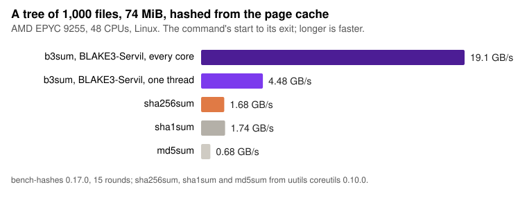

# b3sum

A command-line tool that prints [BLAKE3](https://blake3.io) hashes of files or standard
input, like `sha256sum` or `md5sum`. This is `blake3-servil`'s `b3sum` (see the repository's [README](../README.md)).



# Installation

On Linux, download the binary for your machine from the
[releases page](https://github.com/johnservil/BLAKE3/releases):
`b3sum-VERSION-x86_64-unknown-linux-gnu` or
`b3sum-VERSION-aarch64-unknown-linux-gnu`, each beside its SHA-256 and
BLAKE3 digests. They are statically linked, so each run starts in about
two thirds of the time a dynamically linked build takes, which matters
where `b3sum` runs once per file. Check both digests, then put it on
your `PATH` as `b3sum`:

```
sha256sum -c b3sum-VERSION-TARGET.sha256
chmod +x b3sum-VERSION-TARGET && ./b3sum-VERSION-TARGET -c b3sum-VERSION-TARGET.b3
```

To build it yourself on Linux, with [Rust and Cargo](https://doc.rust-lang.org/cargo/getting-started/installation.html),
link it statically too, giving your machine's target
(`aarch64-unknown-linux-gnu` on 64-bit Arm):

```
RUSTFLAGS="-C target-feature=+crt-static" cargo install b3sums --target x86_64-unknown-linux-gnu
```

On macOS, `cargo install b3sums`. The package is `b3sums` (`b3sum` on
crates.io is official BLAKE3's); the program it installs is `b3sum`, in
`~/.cargo/bin`. (`cargo install b3sum` and the prebuilt binaries on
[official BLAKE3's releases page](https://github.com/BLAKE3-team/BLAKE3/releases)
give official BLAKE3's `b3sum`.)

**For packagers:** build the release binary with `sh tools/b3sum-release.sh`
from a clean checkout of a release tag. On Linux it links statically, as
above, and it writes the binary's SHA-256 and BLAKE3 digests beside it.

# Example

```bash
b3sum foo.txt
```

Time hashing a gigabyte, to see how fast it is on your machine:

```bash
head -c 1000000000 /dev/zero > /tmp/bigfile
time sha256sum /tmp/bigfile
time b3sum /tmp/bigfile
```

# Usage

```
Usage: b3sum [OPTIONS] [FILE]...

Arguments:
  [FILE]...  Files to hash, or checkfiles to check

Options:
      --keyed                 Use the keyed mode, reading the 32-byte key from stdin
      --derive-key <CONTEXT>  Use the key derivation mode, with the given context string
  -l, --length <LEN>          The number of output bytes, before hex encoding [default: 32]
      --seek <SEEK>           The starting output byte offset, before hex encoding [default: 0]
      --num-threads <NUM>     The most threads hashing at once [default: as fast as b3sum can]
      --no-mmap               No effect: b3sum chooses between reading and mapping each file
      --no-names              Omit filenames in the output
      --raw                   Write raw output bytes to stdout, rather than hex
      --tag                   Output BSD-style checksums: BLAKE3 ([FILE]) = [HASH]
  -c, --check                 Read BLAKE3 sums from the [FILE]s and check them
      --quiet                 Skip printing OK for each checked file
  -h, --help                  Print help
  -V, --version               Print version

More information: b3sum/README.md at
https://github.com/johnservil/BLAKE3/blob/servil/b3sum/README.md
```

By default b3sum uses every CPU: several files at once, and a large file over several
threads. `--num-threads 1` hashes on one thread, file by file, leaving the other cores to
other work (or to other b3sums). On Linux, `taskset -c LIST b3sum ...` runs it on chosen
CPUs.

[What `--check` does](what_does_check_do.md) explains checkfiles.
